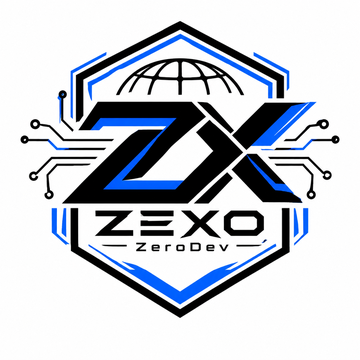

<pre align="center">
          _                      _ _   _           _      _       
         | |                    (_) | | |         | |    (_)      
 _ __ ___| | ___   _ _ __   __ _ _| |_| |__  _   _| |__   _  ___  
| &#x27;__|_  / |/ / | | | &#x27;_ \ / _` | | __| &#x27;_ \| | | | &#x27;_ \ | |/ _ \ 
| |   / /|   &lt;| |_| | |_) | (_| | | |_| | | | |_| | |_) || | (_) |
|_|  /___|_|\_\\__, | .__(_)__, |_|\__|_| |_|\__,_|_.__(_)_|\___/ 
                __/ | |     __/ |                                 
               |___/|_|    |___/                                  
</pre>

Portfolio · M. Rizky Pratama

  

  
  
  

---

## Tentang

Portofolio pribadi berbasis statis (HTML/CSS/JS) yang disajikan dengan GitHub Pages.

## Struktur

- `index.html` — halaman utama
- `about.html`, `404.html` — halaman pendukung
- `assets/`, `images/`, `icon/` — aset

## Jalankan

Buka `index.html` langsung, atau aktifkan GitHub Pages pada branch default.
